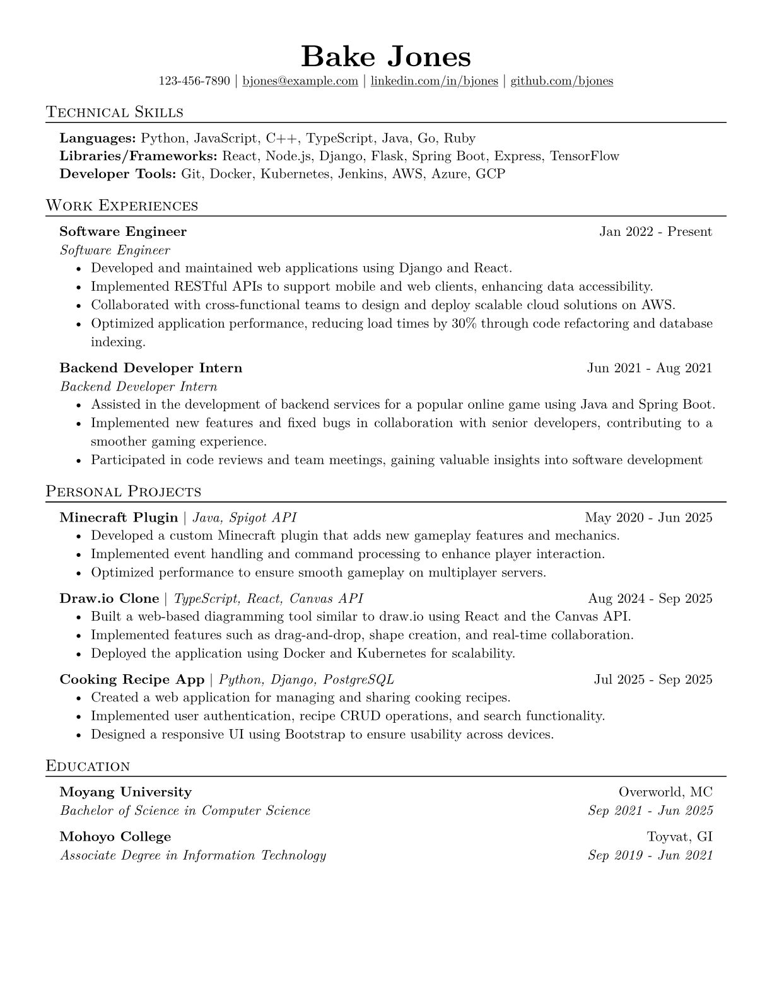

# bakes-resume

bakes resume, written in Typst.



## Requirements

- Install Typst: https://typst.app/docs/install/
- Ensure the `typst` command is available in your shell.

## Usage

- Fork the repo and edit the resume in `src/resume.typ` or the template in `template/resume.typ`.
- Use the project scripts to create or edit job-specific application folders under `applications/`.
- Review the bundled resume templates for a working example.

## Typst CLI

```bash
# Create a job folder and start watching its resume + cover letter
./create.sh 100000 "Moyang" "Software Engineer"

# Reopen an existing job and watch its files again
./edit.sh 100000

# Direct Typst usage for the source templates
typst watch src/resume.typ
typst compile src/resume.typ
```
